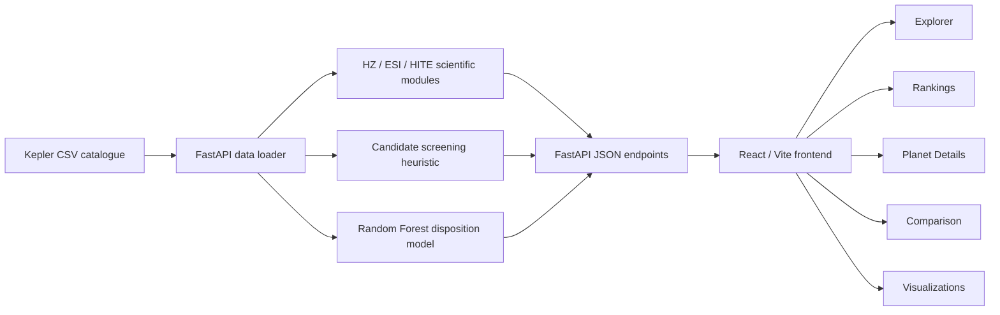

# EXO AI

EXO AI is a full-stack exoplanet exploration and screening application built with React, TypeScript, Vite, FastAPI, Python, and scientific computation modules.

## Problem

Kepler catalogue records contain many measurements and catalogue dispositions, but those values can be difficult to compare. EXO AI organizes the catalogue and presents transparent scientific and model outputs for exploration.

## Features

- Searchable 6,725-record Kepler catalogue
- Planet Explorer with search and numeric filters
- Candidate rankings using a transparent application heuristic
- Individual Planet Details dashboards
- Two-to-three planet comparisons
- Scientific visualizations for catalogue disposition, population, habitable-zone flux, and HITE
- Responsive dark space-themed interface

## Screenshots

> Screenshot placeholders are intentionally left for the portfolio owner to add verified UI captures.

- 
- 
- 

## Architecture



## Technology

- React 18, TypeScript, Vite
- Tailwind CSS
- FastAPI and Uvicorn
- pandas, NumPy, scikit-learn
- Lucide React
- Vitest and React Testing Library

## Scientific interpretation

- **Kopparapu habitable zone:** reports conservative and optimistic stellar-flux boundaries. HZ membership does not prove habitability, water, atmosphere, or life.
- **ESI:** Earth Similarity Index measures physical similarity to Earth. It is not a probability of habitability or life.
- **HITE:** a prioritization metric based on the implemented Barnes, Meadows and Evans methodology. It does not account for every atmospheric or geological factor.
- **Candidate score:** a custom rule-based heuristic using 40% radius, 30% equilibrium temperature, and 30% stellar insolation. It is not a validated habitability probability.
- **Random Forest:** predicts recorded Kepler catalogue disposition — CONFIRMED, CANDIDATE, FALSE POSITIVE, or NOT DISPOSITIONED. It does not predict extraterrestrial life or habitability.

The current backend reports 57.03% test accuracy, 5,380 training records, 1,345 test records, and 200 trees.

## Dataset

The application uses the included `backend/cleankepler.csv` catalogue. Missing measurements remain unavailable instead of being converted to zero. Estimated or derived quantities are not presented as direct measurements.

## Local setup

Requirements:
- Python 3.12
- Node.js 20 or compatible

### Backend

```powershell
cd backend
py -3.12 -m venv .venv
.venv\Scripts\Activate.ps1
python -m pip install -r requirements.txt
python -m uvicorn main:app --host 127.0.0.1 --port 8002
```

### Frontend

```powershell
cd frontend
npm ci
npm run dev
```

The local Vite server uses port 3000 and proxies `/api` to `http://127.0.0.1:8002`.

## Tests

Frontend:

```powershell
cd frontend
npm test
npm run build
```

Backend:

```powershell
cd backend
python -m pytest -q
```

## Deployment

- Backend: Render with `backend` as the root directory
- Frontend: Vercel with `frontend` as the root directory
- API routing: Vercel rewrites `/api/*` to the Render service URL
- SPA routes: Vercel rewrites all non-API routes to `index.html`

Before deployment, replace `REPLACE-WITH-YOUR-RENDER-SERVICE` in `frontend/vercel.json` and set `CORS_ORIGINS` on Render to the Vercel origin.

Live demo URL: **Not deployed yet**

Demonstration video: **Coming soon**

## Limitations

The models and screening indicators are not independent scientific validation. They may be affected by catalogue bias, missing measurements, measurement uncertainty, estimated mass, and model assumptions.
